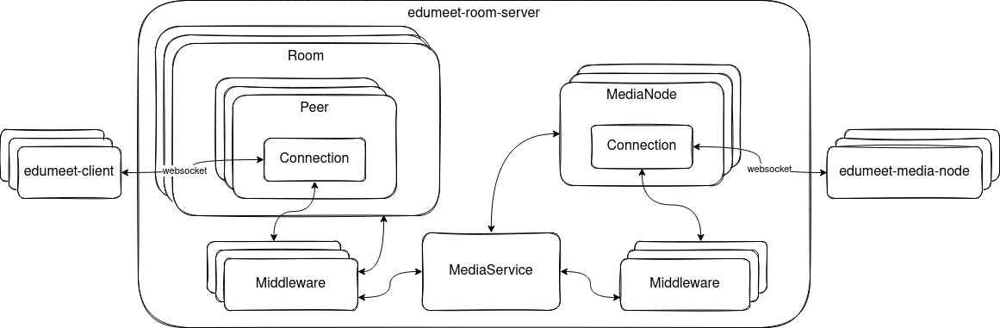

# eduMEET room server guide

This is the room server service for the Edumeet project.
It handles signaling to and from client and media node services.



## Usage

By default, the service reads `./config/config.json`; set `CONFIG_FILE` to use another path. The
[example configuration](../config/config.example.json) shows sample settings but does not include
every optional property. See the [configuration reference](configuration.md) for available options
and their defaults.

The server starts HTTPS only when both `tls.cert` and `tls.key` are configured. If either is missing,
it starts in HTTP mode.

### Reverse proxy
The room-server uses the resolved client IP for media-node selection and bot-token address checks.
If it is behind a reverse proxy, configure the proxy to overwrite `X-Forwarded-For` with the
client's real IP, and list the proxy's address or network in `trustedProxies`. Trust only networks
that clients cannot use to connect directly to the room-server; otherwise they may spoof this
header. See the [configuration reference](configuration.md).

The GeoIP library supports IPv4 and IPv6, but its IPv6 database has no city or region coordinates.
Distance-based media-node selection may not reflect an IPv6 client's actual location, though the
same-country preference can still use the country lookup.

### Running the service manually

```bash
$ corepack enable
$ yarn install --immutable
$ MANAGEMENT_USERNAME=username MANAGEMENT_PASSWORD=password yarn start
```

To run the service you need to have Node.js version 24 or higher installed. This project uses Yarn 4 via Corepack. Alternatively you can get some debug output by running it like this:

```bash
$ LOG_LEVEL=debug yarn start
```

### Docker
https://github.com/edumeet/edumeet-docker/tree/main has guidelines for running all eduMEET-components as docker containers.
To build just edumeet-room-server you can use the included `./Dockerfile` here in this repo.

If the management service is configured, pass `MANAGEMENT_USERNAME` and
`MANAGEMENT_PASSWORD` at runtime, for example with `docker run --env-file`.
Do not put credentials in the Dockerfile.

Building:
```bash
docker build . -t edumeet-room-server
```

Running:
```bash
docker run -v $(pwd)/config:/usr/src/app/config -p 8443:8443 -d edumeet-room-server
```

## Configuration

See the [configuration reference](configuration.md).

## Bots

See [bot behavior and jobs](bots.md).

## Notes

- All file paths are relative to the application working directory unless otherwise specified.
- TLS certificates must be valid and readable by the application.
- Media node secrets **must match** the configuration on the corresponding media node services.

